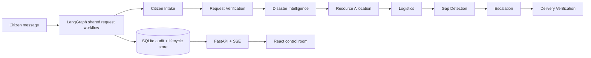

<<<<<<< HEAD
# ReliefChain AI

ReliefChain follows each climate emergency request from intake through verified delivery and highlights who owns the next action. The included flood response is synthetic and is for demonstration only; its metrics are not real-world outcomes.

## Start the demo

Install the pinned service dependencies once, then run `make demo` from the repository root. Open [http://localhost:3000](http://localhost:3000) for the control room and [http://localhost:8000/docs](http://localhost:8000/docs) for the API. The offline extractor and workflow need no API key. `python scripts/run_scenario.py` prints a deterministic replay summary; seed is 42.

On systems without `make`, launch two terminals:

```powershell
cd backend
python -m pip install -r requirements.txt
python -m uvicorn app.main:app --reload --port 8000
```

```powershell
cd web
npm install
npm run dev
```

The browser view refreshes from the API every five seconds. Use the intake composer to run the LangGraph workflow, or the failure buttons to inject a road block, resource stock drop, or request surge. `SIM_SPEED` controls the simulated clock scale. Data is persisted in `backend/reliefchain.db` for local runs.

Run the backend checks with `python -m pytest -q` from the repository root.

## Architecture



Eight specialist nodes pass one typed request context through a LangGraph state graph. Each node records an agent trace with its tool, outcome, and structured details. Critical calculations (priority, dedupe gates, route distance, and allocation) are deterministic. OR-Tools is used when installed; the allocation service has a deterministic fallback. Human review is required for low-confidence critical intake; delivery is never verified without confirmation.

## Lifecycle and safety

The API rejects invalid status transitions with HTTP 409 and appends transition events. The demo supports triage, matching proposals, acceptance/rejection, dispatch/delivery, cancellation, and requester confirmation. A partial/disputed confirmation reopens the request for triage. Low-confidence location intake asks for a pin or landmark. Phone numbers are not shown in the control room. No external SMS, WhatsApp, weather, or mapping service is contacted.

## Limitations

This hackathon build seeds a deterministic 500-request, 15-ward synthetic dataset and a starter agency/resource registry. The map is a stylized local visualization; forecasts, route checks, some scenario actions, and the baseline comparison are illustrative simulation data. Resource coverage and ownership are demo-grade. Production use needs validated local gazetteers, provider adapters, role-based access, retention controls, operationally reviewed authority policies, and field-tested routing and verification.

See [DECISIONS.md](DECISIONS.md) for implementation tradeoffs and [SPEC.md](SPEC.md) for the full target.
=======
# ReliefChain-AI
Multi-agent AI platform for disaster relief coordination, intelligent resource allocation, emergency request tracking, and verified last-mile delivery.
>>>>>>> efd39c12d0eb9a861c1369d7f995a2ac24495353
